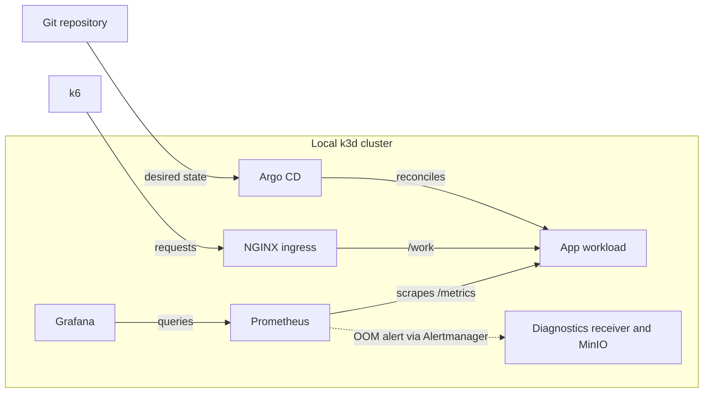
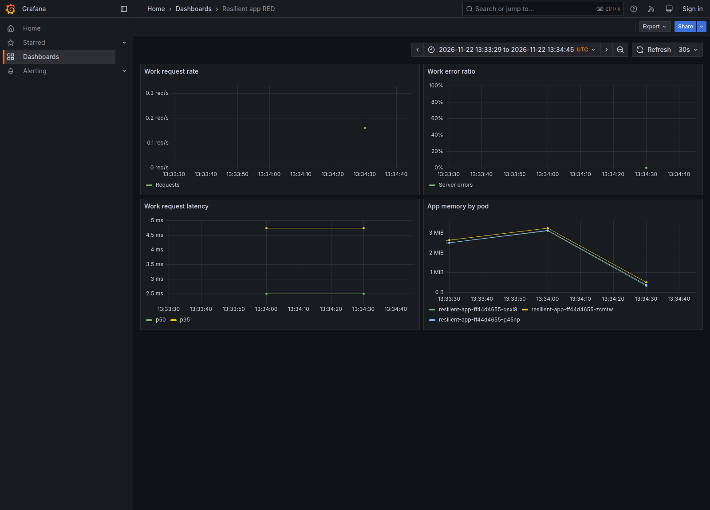
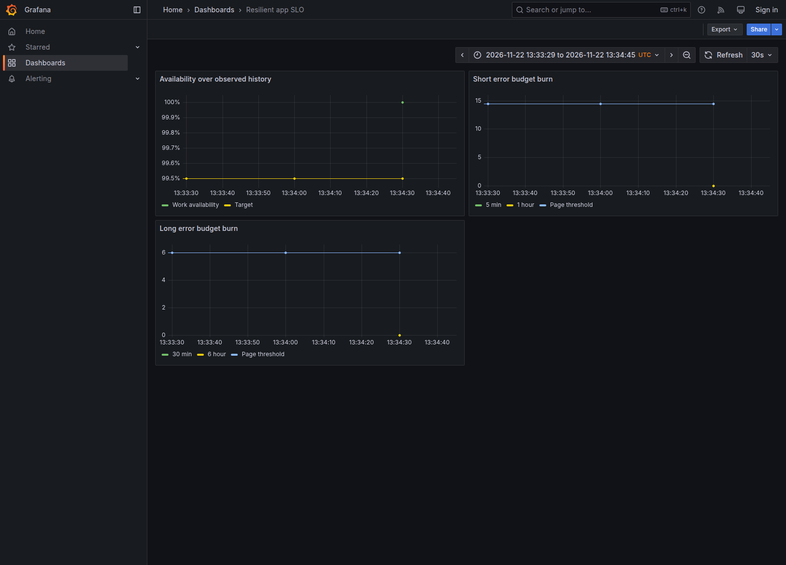

# Self-healing container platform

A bad deploy can send requests to an unhealthy replica and consume the service's error budget. In this k3d lab, tuned probes cut the slow-response request failure rate from 30.80% in profile A to 11.57% in profile B. In a separate bad-release test, Argo Rollouts aborted the canary after about 121 seconds. [Matrix results](results/chaos-matrix/matrix-summary.json) · [Canary results](results/operations/canary-abort.json)

## Results

| Scenario | Evidence |
| --- | --- |
| Pod crash | PodChaos removed the target pod and a ready replacement appeared. [PodChaos log](results/chaos-smoke/pod.txt) |
| Slow response | The app-level fault delayed the selected pod, then reset successfully. [Latency log](results/chaos-smoke/network.txt) |
| Memory exhaustion | StressChaos triggered an OOM kill and the target container restarted. [StressChaos log](results/chaos-smoke/stress.txt) |
| Diagnostics | MinIO held an archive for the terminated pod UID. [Archive record](results/chaos-smoke/oom-archive.json) |
| GitOps rollback | HTTP 200 and three ready replicas returned 7 seconds after the observed revert push. [Rollback results](results/operations/rollback-retest.json) |
| Canary abort | The controller aborted in 120.667 seconds. The bad revision served 31.98% of requests before the abort. [Canary results](results/operations/canary-abort.json) |

The [release verification record](results/README.md) links the recovery matrix, delivery proofs, and operational checks. [Fault smoke evidence](results/chaos-smoke/)

## Architecture



The [core profile](clusters/gitops/core/) provides GitOps, ingress, workload policy and monitoring. The [full profile](clusters/gitops/full/) adds fault injection, automated diagnostics, rollout analysis and resource recommendations. [Architecture and boundaries](docs/ARCHITECTURE.md)

## Failure scenarios

| Scenario | Hosted smoke observation |
| --- | --- |
| Crash | All 4 ingress smoke probes after controller confirmation were healthy. [PodChaos log](results/chaos-smoke/pod.txt) |
| Slow response | The target pod response took 1.504 seconds with the fault active. [Latency log](results/chaos-smoke/network.txt) |
| Memory exhaustion | All 26 ingress smoke probes after controller confirmation were healthy. [StressChaos log](results/chaos-smoke/stress.txt) |

The hosted matrix validated all 180 trials. Each cell shows median and p95 recovery time in seconds, then the k6 request failure rate during the observation windows. Run `make report` to regenerate the table from the checked-in observations. [Complete matrix](results/chaos-matrix/matrix-summary.json) · [Run provenance](results/chaos-matrix/matrix-provenance.json)

| Scenario | A (10 trials) | A2 (10 trials) | B (20 trials) | C (20 trials) |
| --- | --- | --- | --- | --- |
| Crash | 3.10 / 5.75 / 12.31% | 2.72 / 12.29 / 9.65% | 3.12 / 5.64 / 13.99% | 3.33 / 5.75 / 12.07% |
| Slow response | 16.04 / 16.78 / 30.80% | 16.04 / 16.80 / 30.85% | 16.85 / 17.33 / 11.57% | 16.60 / 17.11 / 13.44% |
| Memory exhaustion | 15.84 / 16.13 / 0% | 15.81 / 16.11 / 0% | 15.88 / 16.04 / 0% | 15.90 / 16.25 / 0% |

Hosted latency trials use the app-level control after NetworkChaos failed to configure iptables. [NetworkChaos postmortem](docs/postmortems/2026-11-22-hosted-network-chaos.md) · [Matrix postmortem](docs/postmortems/2026-11-22-hosted-recovery-matrix.md) · [Partial matrix summary](https://github.com/siiick-brain/Self-healing-Container-platforma/actions/runs/45064244265/artifacts/14775560729)

## OpenShift

The [OpenShift comparison](docs/OPENSHIFT_COMPARISON.md) is based on configuration and documentation. Runtime checks remain pending.

| Area | k3d | OpenShift to verify |
| --- | --- | --- |
| Pod admission | Pod security and Kyverno | SCC admission and the assigned pod UID |
| External access | NGINX ingress | Route through the OpenShift router |
| Monitoring | Prometheus and Grafana | User workload monitoring availability |

## Quick start

Use the published implementation and run these commands from WSL2.

```bash
bash scripts/check-environment.sh
make up-core
curl -fsS http://127.0.0.1:8080/work
```

## SLOs

The [SLO policy](docs/SLO.md) sets targets for availability and p95 latency. The [Grafana demo](results/observability/grafana-demo.gif) shows both dashboards with live Prometheus samples from a short lab window. [Dashboard evidence](results/observability/)

<details>
<summary>Grafana dashboards</summary>





</details>

## Cost

Run k3d and object storage locally. CI and image hosting use the public repository. AKS is a static Terraform example. See [scaling and cost](docs/SCALING_AND_COST.md).

## Repository map

| Path | Purpose |
| --- | --- |
| app and charts | Service and Helm packaging |
| clusters and terraform | Local GitOps and static AKS configuration |
| chaos and k6 | Fault experiments and traffic |
| alerts, dashboards and ops | Observability and diagnostics |
| docs, runbooks and results | Procedures and evidence |

## What I would do differently in production

Use multiple control-plane nodes, private ingress for operational endpoints and managed alert routing. Run the failure suite against the actual production topology before committing to recovery objectives. See [architecture](docs/ARCHITECTURE.md) and the [threat model](docs/THREAT_MODEL.md).
