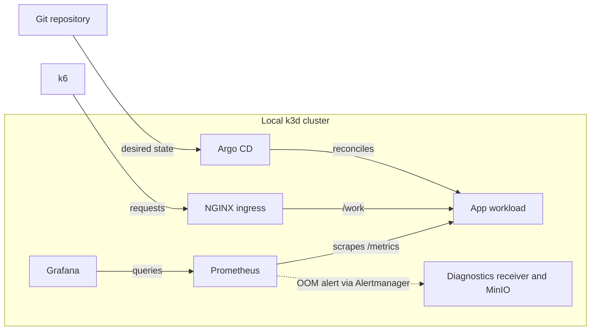

# Self-healing container platform

I built this k3d platform to measure what clients experience during a pod failure or a bad release. I used recovery time and failed requests to evaluate the design because a workload can recover and still consume its error budget along the way. In the slow-response test, the tuned profile cut request failures from 30.80% to 11.57%. In a separate release test, Argo Rollouts aborted the bad canary after about 121 seconds. [Matrix results](results/chaos-matrix/matrix-summary.json) · [Canary results](results/operations/canary-abort.json)

## Results

| Scenario | Evidence |
| --- | --- |
| Pod crash | PodChaos removed the target pod and a ready replacement appeared. [PodChaos log](results/chaos-smoke/pod.txt) |
| Slow response | The app-level fault delayed the selected pod, then reset successfully. [Latency log](results/chaos-smoke/network.txt) |
| Memory exhaustion | StressChaos triggered an OOM kill and the target container restarted. [StressChaos log](results/chaos-smoke/stress.txt) |
| Diagnostics | MinIO held an archive for the terminated pod UID. [Archive record](results/chaos-smoke/oom-archive.json) |
| GitOps rollback | HTTP 200 and three ready replicas returned 7 seconds after the observed revert push. [Rollback results](results/operations/rollback-retest.json) |
| Canary abort | The controller aborted in 120.667 seconds. The bad revision served 31.98% of requests before the abort. [Canary results](results/operations/canary-abort.json) |

For release recovery, I measured a Git revert from the observed push through reconciliation. For the canary, I measured the time to controller abort and the share of traffic that reached the bad revision. Those timings start at different events. [Release verification record](results/README.md) · [Fault smoke evidence](results/chaos-smoke/)

## Architecture



I kept the core profile small enough to bring up for routine changes. It covers GitOps reconciliation, ingress, workload policy, and monitoring. I use the full profile for fault injection, automated diagnostics, rollout analysis, and resource recommendations. Git holds the desired state, and Argo CD reconciles the cluster to it. [Core profile](clusters/gitops/core/) · [Full profile](clusters/gitops/full/) · [Architecture and boundaries](docs/ARCHITECTURE.md)

## Failure scenarios

| Scenario | Hosted smoke observation |
| --- | --- |
| Crash | All 4 ingress smoke probes after controller confirmation were healthy. [PodChaos log](results/chaos-smoke/pod.txt) |
| Slow response | The target pod response took 1.504 seconds with the fault active. [Latency log](results/chaos-smoke/network.txt) |
| Memory exhaustion | All 26 ingress smoke probes after controller confirmation were healthy. [StressChaos log](results/chaos-smoke/stress.txt) |

I held the application image, GitOps revision, and load settings constant across profiles and validated all 180 hosted trials. Each cell reports median and p95 recovery time in seconds, followed by the k6 request failure rate during the observation windows. Run `make report` to regenerate the table from the checked-in observations. [Complete matrix](results/chaos-matrix/matrix-summary.json) · [Run provenance](results/chaos-matrix/matrix-provenance.json)

| Scenario | A (10 trials) | A2 (10 trials) | B (20 trials) | C (20 trials) |
| --- | --- | --- | --- | --- |
| Crash | 3.10 / 5.75 / 12.31% | 2.72 / 12.29 / 9.65% | 3.12 / 5.64 / 13.99% | 3.33 / 5.75 / 12.07% |
| Slow response | 16.04 / 16.78 / 30.80% | 16.04 / 16.80 / 30.85% | 16.85 / 17.33 / 11.57% | 16.60 / 17.11 / 13.44% |
| Memory exhaustion | 15.84 / 16.13 / 0% | 15.81 / 16.11 / 0% | 15.88 / 16.04 / 0% | 15.90 / 16.25 / 0% |

I used the app-level delay for every hosted latency trial after NetworkChaos failed to configure iptables. The latency results apply to that fault mechanism. [NetworkChaos postmortem](docs/postmortems/2026-11-22-hosted-network-chaos.md) · [Matrix postmortem](docs/postmortems/2026-11-22-hosted-recovery-matrix.md) · [Partial matrix summary](https://github.com/siiick-brain/Self-healing-Container-platforma/actions/runs/45064244265/artifacts/14775560729)

## OpenShift

I compared OpenShift's documented behavior with the k3d configuration. The OpenShift runtime checks are still pending. [OpenShift comparison](docs/OPENSHIFT_COMPARISON.md)

| Area | k3d | OpenShift to verify |
| --- | --- | --- |
| Pod admission | Pod security and Kyverno | SCC admission and the assigned pod UID |
| External access | NGINX ingress | Route through the OpenShift router |
| Monitoring | Prometheus and Grafana | User workload monitoring availability |

## Quick start

From the repository root in WSL2, check the environment and start the core profile. The final command verifies that ingress serves `/work`.

```bash
bash scripts/check-environment.sh
make up-core
curl -fsS http://127.0.0.1:8080/work
```

## SLOs

I track request availability and p95 latency because each captures a different way clients can be affected. The Grafana demo shows both dashboards using live Prometheus samples from a short lab window. [SLO policy](docs/SLO.md) · [Grafana demo](results/observability/grafana-demo.gif) · [Dashboard evidence](results/observability/)

<details>
<summary>Grafana dashboards</summary>


</details>

## Cost

I kept the cluster and object storage local and used the public repository for CI and image hosting. The AKS example uses static Terraform validation, so it requires no cloud cluster. [Scaling and cost](docs/SCALING_AND_COST.md)

## Repository map

| Path | Purpose |
| --- | --- |
| app and charts | Service and Helm packaging |
| clusters and terraform | Local GitOps and static AKS configuration |
| chaos and k6 | Fault experiments and traffic |
| alerts, dashboards and ops | Observability and diagnostics |
| docs, runbooks and results | Procedures and evidence |

## What I would do differently in production

The lab has one control-plane node. In production, I'd use a highly available control plane, expose operational endpoints through private ingress, and use managed alert routing. I'd rerun the failure suite against the production topology before committing to recovery objectives. [Architecture](docs/ARCHITECTURE.md) · [Threat model](docs/THREAT_MODEL.md)
