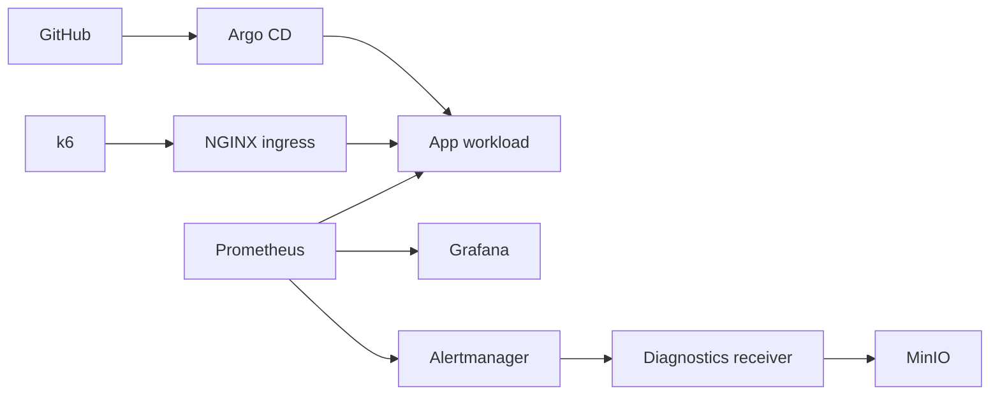

# Self-healing container platform

A bad deploy can interrupt service or return failed requests until healthy traffic resumes. This project measures the difference between basic probes, tuned probes and an automated canary abort on local Kubernetes.

## Results

| Scenario | Evidence |
| --- | --- |
| Crash | Pending a recorded cluster run |
| Slow response | Pending a recorded cluster run |
| Memory exhaustion | Pending a recorded cluster run |
| GitOps rollback and canary abort | Pending separate recorded runs |

Results and raw run outputs belong in [results](results/). See the [experiment procedure](docs/CHAOS.md).

## Architecture



## OpenShift

The [comparison](docs/OPENSHIFT_COMPARISON.md) documents the features to verify on OpenShift.

## Quick start

Use the published implementation and run these commands from WSL2.

```bash
bash scripts/check-environment.sh
make up-core
curl -fsS http://127.0.0.1:8080/work
```

## SLOs

See the [SLO policy](docs/SLO.md) and [platform contracts](CONTRACTS.md).

## Cost

Run k3d and object storage locally. CI and image hosting use the public repository. AKS is a static Terraform example. See [scaling and cost](docs/SCALING_AND_COST.md).

## Repository map

| Path | Purpose |
| --- | --- |
| app and charts | Service and Helm packaging |
| clusters and terraform | Local GitOps and static AKS configuration |
| chaos and k6 | Fault experiments and traffic |
| alerts, dashboards and ops | Observability and diagnostics |
| docs, runbooks and results | Procedures and evidence |

## What I would do differently in production

Use multiple control-plane nodes, private ingress for operational endpoints and managed alert routing. Run the failure suite against the actual production topology before committing to recovery objectives. See [architecture](docs/ARCHITECTURE.md) and the [threat model](docs/THREAT_MODEL.md).
